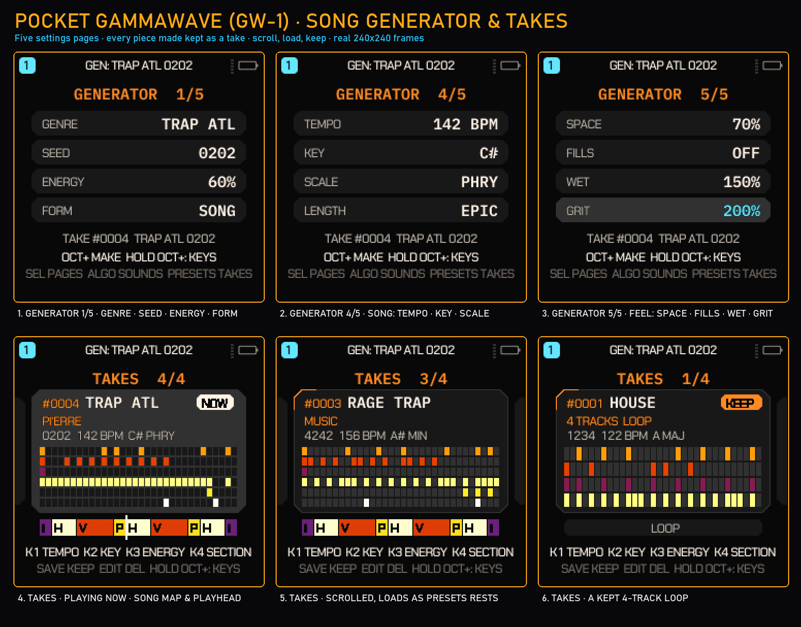
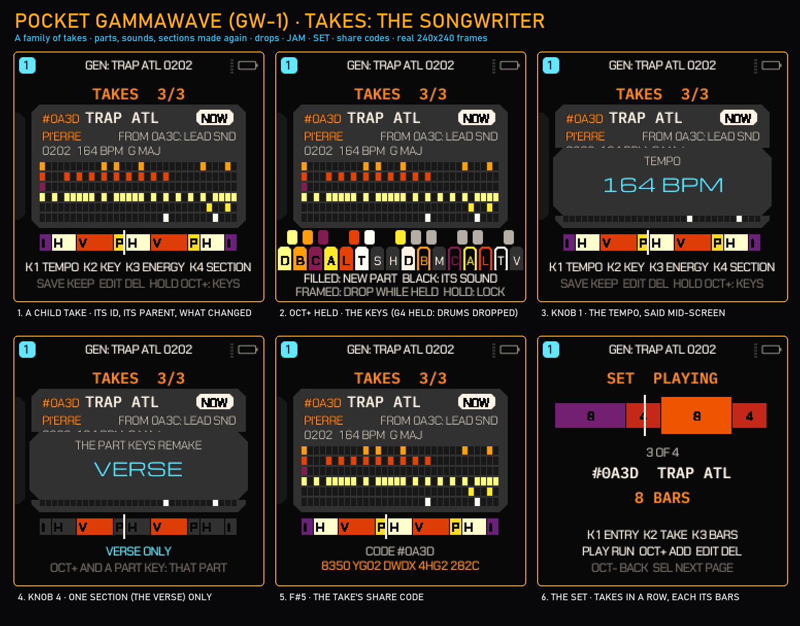
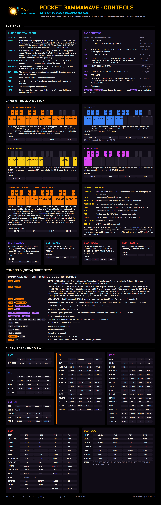
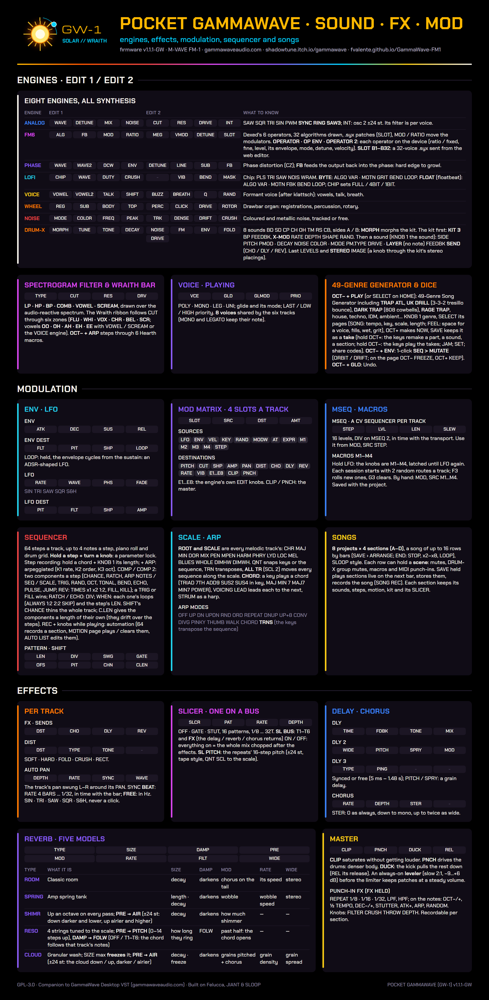

# QUANTUM GAMMAWAVE (QG-1) — M-VAVE FM-1 Synthesizer & Groovebox Firmware

**Quantum GammaWave (QG-1)** is an advanced open-source firmware and Web Studio for the **M-VAVE FM-1 multitrack FM synthesizer and groovebox**. It is a major evolution and fork of [Pocket GammaWave (GW-1)](https://github.com/fvalente/GammaWave-FM1) by Leo Kuroshita / Hügelton Instruments, built upon [JIANT FM](https://github.com/juanjiant-bit/JIANT) and [Felucca](https://github.com/hugelton/Felucca), and companion to the **[GammaWave desktop synthesizer](https://gammawaveaudio.com/)**.

[](https://shadowtune.itch.io/gammawave)
[](https://gammawaveaudio.com/)
[](https://guillel51.github.io/Quantum-GammaWave/)
[](https://guillel51.github.io/Quantum-GammaWave/webapp/editor/)
[](https://guillel51.github.io/Quantum-GammaWave/webapp/installer/)
[](LICENSE)

> **Like the sound and workflow?** The full **[GammaWave desktop synth](https://shadowtune.itch.io/gammawave)** is a dual-oscillator hybrid (subtractive, FM, granular) with the Hearth saturation engine, a 7-engine filter, 3-layer granular FX, 32-voice polyphony and full DAW automation — VST3 and Standalone on Windows, macOS and Linux, plus AU on macOS.
> - **Buy the desktop plugin:** <https://shadowtune.itch.io/gammawave>
> - **Official website:** <https://gammawaveaudio.com/>
> - **Try the firmware in your browser (emulator):** <https://guillel51.github.io/Quantum-GammaWave/>
> - **Web Studio (editor, demo songs, tape lanes):** <https://guillel51.github.io/Quantum-GammaWave/webapp/editor/>
> - **USB web installer:** <https://guillel51.github.io/Quantum-GammaWave/webapp/installer/>

---

## Hardware screens (240×240)


*Real 240×240 RGB565 frames from Pocket GammaWave (`v1.0-GW` and `v1.1-GW`). Top row: **HOME** (filter curve over an audio-reactive spectrum, the Hearth sun with its orbiting moon, tracks T1–T6), **EDIT 1** of ANALOG (two live scopes over the Wraith ribbon) and **EDIT 1** of the VOICE engine (the vowel ribbon OO · OH · AH · EH · EE). Bottom row: the **SLICER** page (drawn as four tape lanes), **FX > MASTER** (CLIP / PUNCH / DUCK and the FX rack) and the **DRUM** kit page (8 pads, A/B morph).*

### The song generator and its TAKES reel



*Real frames of the GEN screen, rendered by the firmware's own drawing code in the GAMMA palette (`docs/gw1-generator.png`). Top row: three of the generator's five settings pages, turned with **SELECT** — **1/5** genre, seed, energy, form; **4/5 SONG** (tempo, key, scale, length); **5/5 FEEL** (space for a voice, fills, wet, grit; the knob last turned is lit). Bottom row: **PRESETS** opens the reel on **NOW**, the piece playing: its card says it is **EDITED** (or which take it is) and where it came from (`FROM TAKE 4: SOUNDS`), the genre and its trap flavour (or the tracks and the form), the seed, tempo, key and scale, the first two bars of each live track (one row a track, coloured by its part) and the song's sections as blocks (trap: **I**ntro, **H**ook, **V**erse, **P**re-hook) with the playhead. Then the **takes you saved** (SAVE), numbered (**TAKE 3 OF 4**), each with its own ID; scrolled while playing, a take plays on the next bar. On the reel the knobs are **TEMPO, KEY, ENERGY, SECTION**.*

### TAKES: the songwriter



*The TAKES reel as a songwriting tool (`docs/gw1-takes.png`, real frames). **1** **NOW** after a change: **EDITED**, from take 2, what changed (`FROM TAKE 2: LEAD SND`) — no take was made. **2** **OCT+ held**: the whole screen maps the keys, each in its part's colour, the parts' names under them; the key down said in full (`G3 BASS: NEW NOTES WHEN LET GO`); the right half mirrors the left: the same parts dropped while held; C#5 ORIG back to the take, D#5 JAM, F#5 the code. **3** **OCT− held**: the white keys play takes 1–16 on the next bar, like clips. **4** **SAVE**: NOW kept as take 3, said in the band at the foot of the screen. **5** The **SET**: takes in a row, each for its bars, recorded with REC from the takes you play; while it plays KNOB 1 jumps to an entry. **6** **F#5** shows a take's **share code** (OCT+ held + SAVE types one in: the same firmware makes the same piece).*

---

## What's in Pocket GammaWave (`v1.3-QG`)

- **GammaWave HUD** on the FM-1's 240×240 screen, in the GAMMA palette (default), plus THERMAL and WRAITH palettes:
  - **HOME**: the selected track's filter response curve drawn over a 28-bar audio-reactive spectrum display, the Hearth sun with an orbiting moon, and the T1–T6 track strip.
  - **EDIT pages**: two live scope traces above the **Wraith ribbon** — six zones (`FLU` · `WHI` · `VOX` · `CHR` · `BEL` · `SCR`) whose needle follows the filter cutoff (and the filter LFO). With the VOWEL or SCREAM filter, or the VOICE engine, the ribbon shows the vowels `OO` · `OH` · `AH` · `EH` · `EE` instead.
  - Boot splash with the Hearth sun and `POCKET GAMMAWAVE // GW-1`; the ABOUT page carries a QR code to gammawaveaudio.com.
- **Two new filter types and four new drive types** on every track: filter `VOWEL` and `SCREAM` (after `LP`, `HP`, `BP`, `COMB`), drive `HEARTH`, `BLAST`, `PLASMA` and `FLUX`.
- **49-genre song generator (GEN)** — open it with **`[OCT−] + [PLAY]`**, or turn **SELECT** on HOME. Page 1: **KNOB 1** genre, **KNOB 2** seed, **KNOB 3** energy, **KNOB 4** form (LOOP / PARTS / SONG); **SELECT** turns the five pages (drums, bass, chords, arp; lead, complexity, swing, humanize; SONG: tempo, key, scale, length; FEEL: space, fills, wet, grit); **ALGORITHM** gives the piece new instruments (the notes kept); **OCT+** makes the piece, **PLAY** auditions it, **HOME** closes. The piece playing is **NOW**: every change shapes NOW (on the next bar while playing) and **SAVE keeps it as a take** — the **TAKES** reel (**PRESETS**) holds only the takes you saved (32, kept over power-off): scroll it (round) and the take under the cursor plays on the next bar (OCT+ or PLAY when stopped); there **KNOB 1–3** are the tempo, key and energy, **KNOB 4** picks a section, **EDIT** deletes, **OCT−** goes back. **GLO + G4 / A4** step NOW back and forward. Hold **OCT+** and the whole screen maps the keys: remake one part, one sound, one section, the harmony, the mix, **drop a part while held**, **C#5** back to the original take, **D#5** **JAM** (NOW changed by itself every few bars), **F#5** the **share code** (**OCT+ + SAVE** types one in). Hold **OCT−** and the white keys **play takes 1–16** on the next bar; **REC** records them as a **SET**. What a control did shows in a band at the foot of the screen. Genres include:
  - **`TRAP ATL`** (136–150 BPM, half-time bounce, 808 sub, hi-hat rolls and triplets, bell / flute / key melodies)
  - **`UK DRILL`** (140–145 BPM, 3-3-2 hi-hat gallop, late snare, sliding 808, dark strings and choirs)
  - **`DARK TRAP`** (130–148 BPM, Memphis-style cowbell, clipped 808, phrygian bells)
  - **`RAGE TRAP`** (140–160 BPM, Whole Lotta Red or MUSIC flavour: square video-game leads or wobbling stabs, a crushed 808)
  - plus `GAMMAWAVE`, `WRAITHWAVE`, house, techno, trance, electro, EBM, synth pop, darkwave, post punk, motorik, funk, disco, boom bap, UK garage, dubstep, breaks, drum & bass, dub, jazz, bossa, afrobeat, ambient, neo-classical, soundtrack, IDM and more.
  - Pieces are 32 or 64 steps (2 or 4 bars per section) depending on the genre's chord rhythm.
- **One-press MUTATE** — **`[OCT−] + [ENV]`** jumps to **SEQ > MUTATE**. If MUTATE was off on the track it switches it on with SOUND every 2 bars, PATTERN every 4 bars and AMOUNT ≈ 50 %:
  - **`ORBIT`** (the default) mutates notes and timbre while pulling back toward the original pattern; **`DRIFT`** keeps wandering. Intervals: 1, 2, 4, 8, 16 or 32 bars.
  - On the MUTATE page **OCT−** freezes the current mutation and **OCT+** keeps it as the new pattern.
- **Hearth macros** — **`[OCT−] + [ARP]`** steps through six drive/filter macros (`1/6 HEARTH GRAVITY` … `6/6 SOLAR ECLIPSE!`); macros 4–6 switch the filter to SCREAM or VOWEL, and 6 also raises the master DUCK and PUNCH. `[OCT−] + [GLO]` takes a macro back.
- **Hidden visualizer** — **`[OCT−] + [HOME]`** (or MENU > ABOUT, then OCT+): four animated scenes, `1/4 SUPERNOVA`, `2/4 WRAITH 3D`, `3/4 WARP TUNNEL`, `4/4 MATRIX FFT`, which pulse while the sequencer plays. **OCT+** (or PRESETS / ALGORITHM) changes scene, **OCT−** leaves.
- **Web Studio** (browser, [webapp/editor](https://guillel51.github.io/Quantum-GammaWave/webapp/editor/)) — edits the FM-1 live over Web MIDI, or runs on its own in simulator mode:
  - four instant demo songs and its own 49-genre generator (the same genre list; its patterns are generated in the browser and won't match the device's for the same seed);
  - **4 tape lanes (T1–T4)**: DUMP a track's pattern into a lane, layer and bounce lanes, mute and clear them — they hold note patterns, not recorded audio;
  - **EXPORT .WAV**: renders the current song and the tape lanes to a 16-bit **44.1 kHz** stereo WAV for your DAW;
  - the Wraith bar (six zone buttons, a 0–127 slider, or drag on the LCD) and SEQ MUTATE (MUTATE NOW, ORBIT, DRIFT, AMOUNT, FREEZE, KEEP ANCHOR).

---

## The `[OCT−]` shift deck

Hold **`[OCT−]` on its own first**, then press the second button. (A plain OCT− tap still lowers the octave; the octave is put back when a shortcut fires.) The deck works from HOME and the parameter pages — not inside menus or dialogs, and not on pages where OCT− has its own job (on MUTATE it is FREEZE).

| Shortcut | Action |
| :--- | :--- |
| **`[OCT−] + [ARP]`** | Next of the 6 Hearth macros (drive type and amount, cutoff, resonance, filter type) on the selected track |
| **`[OCT−] + [PLAY]`** *(or `[REC]`)* | Open the 49-genre generator (GEN) |
| **`[OCT−] + [ENV]`** *(or `[SCL]`)* | Jump to SEQ > MUTATE (switches MUTATE on if it was off) |
| **`[OCT−] + [HOME]`** *(or `[SAVE]`)* | Open the visualizer |
| **`[OCT−] + [SEQ]`** | Dice the selected track's sequence |
| **`[OCT−] + [EDIT]`** | Dice the selected track's sound |
| **`[OCT−] + [FX]`** / **`[OCT−] + [LFO]`** | Dice the track's FX / LFO |
| **`[OCT−] + [GLO]`** *(or `GLO + G4`)* | Undo; again: redo |

The editing actions ask you to stop the song chain first (`STOP TO EDIT`), as their GLO-layer versions do.

**Selecting tracks:** turn **ALGORITHM** to select T1–T6 from any page. Tap **EDIT** repeatedly to step through the engine's pages: EDIT 1 → EDIT 2 → (MORPH, RETRIG or the FM6 operator pages, depending on the engine) → FILTER → VOICE.

---

## Printable cheat sheets

| Controls & shift deck | Sound · filter · FX · mod |
| --- | --- |
| [](docs/cheatsheet-controls.png) | [](docs/cheatsheet-sound.png) |
| Every knob, button, held keymap layer (`FX`, `GLO`, `SAVE`, `EDIT`, `LFO`, `SCL`, `SEQ`, `REC`, and the TAKES layer: `OCT+` held on the reel) and page knob assignment. **[PDF](docs/cheatsheet-controls.pdf)** | The synthesis engines, filter types, the `MOD` matrix, `MSEQ`, `MUTATE` and master FX. **[PDF](docs/cheatsheet-sound.pdf)** |

Full user manual: **[English (`docs/MANUAL.md`)](docs/MANUAL.md)** · **[Español (`docs/MANUAL.es.md`)](docs/MANUAL.es.md)**. Chapter 17 of the manual gathers the GW-1 additions (the shift deck, the Hearth macros, GEN, the new filter and drive types, the screens and the visualizer).

---

## Synthesis engines & sound architecture

### 1. Eight synthesis engines (no samples)
- **`ANALOG`**: dual virtual-analog oscillators (`SAW`, `SQR`, `TRI`, `SIN`, `PWM`, `SYNC`, `RING`, `SAW3`, and the dirty sines `TUBE` — GammaWave's Hearth tube curve — and `FOLD` — WRAITH's Blast wavefolder — whose amount is MORPH plus ENV/LFO → SHAPE) with interval (`INT ±24 st`), detune, oscillator mix and noise, through the track filter (`CUT`, `RES`, `DRIVE`).
- **`FM6`**: 6-operator DX7-style FM (DX7 `.syx` voices load through the Web Studio), the 32 algorithms drawn on screen, per-operator editing on the device (`OPERATOR`, `OP ENV`, `OPERATOR 2`) and a 32-voice user bank (`B1–B32`; until you send one, `B1–B11` hold **GW-1 KEYS**, built in: electric pianos, bells, mallets, pads).
- **`PHASE`**: CZ-style phase distortion with feedback (`FB`), from warm brass to digital growl.
- **`LOFI`**: 1-bit, 4-bit and 8-bit chip voices plus 32-formula **Bytebeat (`BYTE`)** and **Floatbeat (`FLOAT`)** engines tuned to the keyboard scale.
- **`VOICE`**: formant voice (`VOWEL`, `VOWEL2`, `TALK`, `SHIFT`, `BUZZ`, `BREATH`) — its EDIT page shows the vowel ribbon.
- **`WHEEL`**: tonewheel drawbar organ with rotary speaker, key click and harmonic percussion.
- **`NOISE`**: tuned and free-running resonant / metallic noise for risers, snares and industrial textures.
- **`DRUM`** (the DRUM-X kits): 8 synthesized pads (`BD`, `SD`, `CP`, `CH`, `OH`, `TM`, `RS`, `CB`) with A/B kit morphing (`MORPH`), wavefolder (`FOLD`), `FM ENV`, an 808 long pitch-drop mode (`PMOD LONG`) and tempo-synced `X-MOD`.

### 2. Filters and the Wraith ribbon (`EDIT > FILTER`)
Every track's filter offers `LP`, `HP`, `BP`, `COMB`, `VOWEL` (a state-variable filter blending low-pass, band-pass and a saturated notch for a vocal colour) and `SCREAM` (a state-variable filter with a saturated integrator, for screaming resonance). The **Wraith ribbon** labels the cutoff range with six zones (**`FLU` · `WHI` · `VOX` · `CHR` · `BEL` · `SCR`**); turning CUT sweeps the needle across it.

### 3. Punch-in FX, slicer, 5 reverbs & master bus
- **Playable punch-in FX (`FX` held + keys)**: quantized performance effects (`REPEAT 1/8 · 1/16 · 1/32`, `LPF`, `HPF`, `OCT-/+`, `1/2 TEMPO`, `DEC-/+`, `STUTTER 1/8 · 1/16`, `ATK+`, `ARP`, `RANDOM`), recordable into a 4-bar automation lane per section.
- **5 reverb models**: `ROOM`, `SPRING`, `SHIMR` (octave-up shimmer), `RESO` (4 scale-tuned sympathetic strings) and `CLOUD` (pitch-granulated freeze wash).
- **Master bus (`FX > MASTER`)**: `CLIP` (level-compensated soft clipper), `PUNCH` (drum transient saturator), `DUCK` (kick-triggered sidechain pump) and an always-on 2:1 auto-leveler.

### 4. Dual-core audio engine (JieLi AC791N)
Some synth tracks run on the FM-1's second core, with per-block checksums and a watchdog. If the second core ever faults, the firmware shows a notice and stays on one core until power-off. Hold **`REC`** at power-on to force single-core mode.

---

## Installing on M-VAVE FM-1 hardware

> **(QG-1)** Web installer with SHA-256 check, pre-flight checklist, *verify only* and an automatic backup over
> GammaWave/JIANT; one-click launchers in `tools/install/` (`install-fm1.sh`, `.command`, `.bat`); CLI `tools/fm1_install.py
> --verify-only / --sha256`. Recovery guide (es): [docs/INSTALL.es.md](docs/INSTALL.es.md). Emulator while coding:
> `python3 tools/emu_dev.py` (rebuilds on every change and reloads the page).

1. **Open the USB web installer** in Chrome, Edge or Opera (it needs Web MIDI):
   **<https://guillel51.github.io/Quantum-GammaWave/webapp/installer/>**
2. Connect the **M-VAVE FM-1** with a USB data cable and switch it on.
3. **Coming from another custom firmware (Felucca, baudgirl, etc.)?** Click **Return to official V15 first** (which also backs up your flash), then click **Install**.
4. **Coming from official V15, JIANT, or an earlier Pocket GammaWave build?** Click **Install** directly. Don't unplug the cable until flashing completes.

*Pocket GammaWave uses the FM-1's user sample flash (`USR1–3`) to store 8 multi-section songs and the 32-voice FM6 user bank. Back up any custom WAV samples from stock firmware before flashing.*

You can also download the package from the **[Releases page](https://github.com/fvalente/GammaWave-FM1/releases)** (named `felucca-<version>.fwsc`, e.g. `felucca-1.1-GW.fwsc` — the build tooling keeps Felucca's file name).

---

## Building from source

See **[BUILDING.md](BUILDING.md)** for the toolchain (JieLi clang, the AC79 SDK files) and the options:

```bash
./build.sh                                                       # build/felucca.fwsc (needs JIELI_TOOLCHAIN and AC79_SDK)
sh web/emu/build.sh                                              # the WebAssembly emulator in build/emu (needs emcc)
python3 web/make_site.py build/felucca.fwsc v1.3-QG build/site   # the Web Studio + USB installer
```

On Windows, `tools/build_windows.py` drives the same build inside WSL2 Ubuntu (edit its toolchain paths first).

---

## Changelog

### `v1.0-GW` — Pocket GammaWave (`GW-1`)
- **GammaWave HUD** (`ui_being.c`, `ui_tech.c`): HOME with the filter curve over a 28-bar audio-reactive spectrum, the Hearth sun and moon, and the T1–T6 strip; EDIT pages with two scopes and the Wraith ribbon; the SLICER drawn as tape lanes; GAMMA (default), THERMAL and WRAITH palettes; a GammaWave boot splash and an ABOUT page with a gammawaveaudio.com QR code.
- **New filter types `VOWEL` and `SCREAM`**, and drive types `HEARTH`, `BLAST`, `PLASMA`, `FLUX`.
- **49-genre generator** (`gen.c`, `gen_tables.c`): adds `GAMMAWAVE`, `WRAITHWAVE`, `TRAP ATL`, `UK DRILL` (3-3-2 hat bounce), `DARK TRAP` (808 cowbells) and `RAGE TRAP`, with 808 glide bass and hi-hat rolls.
- **`[OCT−]` shift deck** (`ui_input.c`): Hearth macros, GEN, the MUTATE jump, the visualizer, track dice and undo — see the table above.
- **Web Studio** (`web/editor.html`): demo songs, its own 49-genre generator, 4 tape lanes with WAV export, the Wraith bar and SEQ MUTATE.

### Fixes since the first `v1.0-GW` package (published as `v1.0-GW-8f5e254`)
- `[OCT−] + [HOME]` now keeps the visualizer open (letting go of HOME closed it at once).
- Pressing a page button and OCT− at the same moment is the page's own gesture again (FX + OCT− no longer dices FX).
- The Hearth macros only touch ANALOG's E4/E5 cutoff/resonance on ANALOG tracks (on other engines those slots are other parameters), reset the filter type for macros 1–3, and can be undone; the deck's undo shows `UNDONE (AGAIN: REDO)` and respects `STOP TO EDIT`.
- The MUTATE jump enters the page properly (sequencer mode and page state follow).
- Generated DRUM kits are tuned around their own pitch again (TUNE was set about an octave flat).
- ABOUT: the QR code no longer covers the license line.

### `v1.2.1-GW` — CLEAR PROJECT and fixes from upstream (2026-10-26)

A clear tool from the issues, and fixes taken from the firmware Pocket GammaWave is built on ([JIANT](https://github.com/juanjiant-bit/JIANT) 0.7.8 to
0.9.18, [Felucca](https://github.com/hugelton/Felucca) after 1.6.1).
- **No click after a slow block** (JIANT 0.8.9). The audio interrupt acknowledged a half of the buffer only after it
  rendered it, so a render that ran late lost the next half: 2.9 ms of old audio played again, a click (and USB audio
  came up short). Now the half is acknowledged first and a late render is caught up at once. The USB console counts
  any half still lost (`audio_lost`).
- **DRUM-X STEREO clean on two cores** (JIANT 0.7.8). With IMAGE on, the kit's sides were one set for both cores, and
  the other core's part cleared them mid-render: grit like a downsampling and clicks on the side a sound leaned to.
  Each core now has its own. The kit's DRV / knee now scales the sides as it scales the sum, so a loud hit's side is
  never over-taken.
- **CLOUD** (JIANT 0.9.14 / 0.9.16). Pushed hard (high RATE and SIZE, a hot send), its loop could run away into
  clipping: the crackle. Now the grains' overlap is capped, the line rounds off softly instead of clamping, a low cut
  keeps DC out of the loop, and with AIR up no grain reads across the write head (a click each). SIZE at max on an
  empty line froze silence: it now takes ~0.7 s of sound first, then holds.
- **The delay at its longest TIME with MOD up** (JIANT 0.8.4) no longer leaks the dry input into the echoes (up to
  −7.5 dB at MOD 127): every read stays inside the line.
- **LFO FREE** (JIANT 0.9.18): its FADE no longer comes back on every note; it fades in once, when a project loads.
- **A BPM of 0 never divides** (Felucca #282).
- **NOISE, a smooth random LFO** (issue #20; JIANT 0.7.8): a new source in the modulation matrix (LFO > MOD, KNOB 2 SRC).
  Each track wanders on its own, a new value about every 46 ms with an eased glide between, instead of RAND's one value
  per note or the LFO's S&H steps. Route it to CUT, PITCH, PAN or an engine value for a sound that keeps moving.
- **SAVE > TOOLS > 7 CLEAR PROJ** (issue #22): frees the current project's sections A–D and empties its song, after a
  confirm (no UNDO); the music playing stays. Until now a stored section could never be freed, so once A–D were taken
  the generator's SONG form had nowhere to write.
- **RAM**: the project staging buffer moved to the pool (JIANT 0.8.4): 3.8 KB of main RAM back for later features.

### `v1.2-GW` — Ambient & Keys (2026-10-25)

- **21 new presets** for pads, drones, strings and keys (issue #17), on the engines already there: no new engine, and
  nothing else in the sound changes.
  - ANALOG: **EVOLVE PAD** (a slow LFO on the filter, each note its own mix: it drifts by itself), **SOLINA** (a
    string machine: three saws, the ensemble chorus), **DEEP DRONE** (a fifth that breathes);
  - PHASE: **CRYSTAL PAD** (its brightness swept slowly), **HAZE STRINGS**; VOICE: **SOFT CHOIR**, **ANGEL AIR**;
    WHEEL: **DRONE ORGAN**; NOISE: **OCEAN**, **DUST HAZE**;
  - FM6: **SOFT EP**, **REED PIANO**, **FM PIANO**, **GLASS KEYS**, **CRYSTAL BELL**, **KALIMBA**, **VIBES**,
    **MUSIC BOX**, **WARM PAD**, **GLASS PAD**, **CELESTA**; velocity opens their brightness.
- **GW-1 KEYS, an FM6 bank built in.** Until you send a bank from the Web Studio, FM6's SLOT **B1–B11** hold these
  eleven voices (the FM6 presets above play them; the Web Studio's bank list names them). A bank you send replaces it,
  as before. `web/banks/gw1-keys.syx` is the same bank as a 32-voice file, to edit or to send back.
- A preset can now set a few more of a sound's values (its LFO, the modulation matrix): that is how the pads move.
- **The generator does not pick the new presets**: a share code makes the same piece as on v1.1.1. Make a piece, then
  load them on its tracks with PRESETS.
- **Fixed on the way:** a preset set to an FM6 bank slot kept the sound before it instead of loading its voice (no
  factory preset used one until now).

### `v1.1.1-GW` — from the issues (2026-10-24)

- **Automation you can see** (issues #2, #10: "the values keep changing by themselves"). A knob moved while its track
  is armed and playing is recorded as automation, as before, but nothing on the screen said so. Now:
  - the first time a knob gets automation, the header says it and which REC chord clears it
    (`AUTOMATED. REC+ENV CLR`);
  - an automated knob's card shows an **A**: in its knob on the GAMMA look, as a chip after the label on the others.
    The old marker, a tiny motion icon in the theme colour, was easy to miss.
- **MENU > GEN > SELECT ON HOME** (issue #3): **GENERATOR** (the default, as before) or **TEMPO**, which makes SELECT
  alone on HOME turn the tempo. The generator stays on HOME held + SELECT and OCT− + PLAY. GEN is a new, fifth MENU
  tab; the tab bar's cushions are a little narrower so five fit.
- **Fixed on the way:** the MENU's MIDI OUT and LOAD rows did not redraw their value when it changed (the menu's redraw
  check left them out).
- README: the download's file name.

### `v1.1-GW` — the songwriter (2026-10-24)

Everything below from `v1.0-GW-e3a5a33` up, as one release (package `felucca-1.1-GW.fwsc` on the GitHub release; the
web installer already ran each build as it was published):

- **Trap family in the generator**: TRAP, TRAP ATL, UK DRILL, DARK TRAP and RAGE TRAP get a generator of their own,
  with producer flavours, ten 808 recipes ported from GammaWave and WRAITH, and ANALOG's new TUBE and FOLD waves for
  dirty 808s.
- **GEN, more pages**: SONG and FEEL; SELECT picks the genre, ALGORITHM the seed; takes while playing.
- **TAKES: the songwriter**: every piece goes on a reel. Takes come from the one playing (re-instrument, new drums,
  new melody …). A section can have its own parts; JAM makes takes by itself; the SET records an arrangement. The reel
  and the SET survive power-off, and share codes pass a take on.
- **NOW and takes you choose**: turning knobs and pressing keys edits the music playing (NOW). A new take is made only
  when you save it (SAVE, or OCT+ held for its code). There is an undo one step back and an undo to the original. OCT+
  held shows the full key map.
- **The GEN screen**: one control model on every page, no conflicts between the take layer and the keys. Big pop-ups
  say what changed, and the screen no longer flashes or cycles on every change.
- **The SET plays whole phrases**: each entry is recorded as whole loops of its take, and opening the reel no longer
  changes the music.
- **A real trap snare and clap**: DRUM-X gets two new sound models, **SNARE** and **CLAP** (EDIT > SOUND 3 > MODE),
  built at full rate and fitted to producer one-shots. The trap genres use them, and the snare finally cuts through
  the 808.

The sections below give the detail of each published build.

### The trap snare and clap (PR #14)

**Reported:** in RAGE TRAP the snare part was weak; then, with an 808-shaped snare, "not much audible"; and the clap
was a bad snare-like hiss.

**What it was.** DRUM-X's CLASSIC sounds are one oscillator and one filtered noise, computed at half rate with a
smooth exponential envelope. Producer snares are something else: hard-clipped, held at full level for 20–60 ms,
mid-heavy (1–4 kHz), with a tuned body at ~330–470 Hz. In the mix the old snare sat about 5 dB under the 808 below
500 Hz, and every hit was flattened to the same peak by the drum bus.

**The fix.** Each DRUM-X sound now has a **MODEL**: CLASSIC as before, or the new **SNARE** and **CLAP**. They are
computed at full rate:
- a tuned body (with its octave below), a stick click, and two bands of rattle;
- held at full level, then their tails (SNAP: gated);
- pushed into a clipper at twice the rate, **CLIP** 0–15 on SOUND 3's KNOB 3.

CLAP strikes its rattle three times, PMOD apart (~4–12 ms). Fitted to the user's reference one-shots, they come within
a few dB per octave of them, at their pitch.

**In the trap genres** the snare is one of two characters (a clipped crack at ~330 Hz, a tight one at ~465 Hz with
its octave below). The clap is CLAP with its strikes either ~10 ms apart or tight (~5 ms, no flam against the snare;
on CLAP, PMOD sets the spread). Both are dry. In RAGE TRAP 0161 the snare and clap now sit
~5 dB above the rest of the mix at each hit (was ~0.6 dB under it). Pieces keep their codes: the generator draws
nothing new.

**Compatibility:** saved projects keep their kits; a project with a SNARE or CLAP sound stores it in a new FUNC block
('D' 'X'), which earlier firmware ignores (it plays those sounds as CLASSIC).

### Published as `v1.0-GW-fbf5d6e` — the SET plays whole phrases (PR #13)

**The SET plays whole phrases** — reported: in a SET, the first take did not play completely. REC counted the take
already playing from the moment REC was pressed (part of its loop), and played back from its top the entry cut the
phrase short; a take launched and left for part of a loop did the same. **An entry recorded is now whole loops of its
take** (the nearest, one loop at least; a SONG take keeps its bars as played). The entries' bars can still be set by
hand on the SET page (KNOB 3).

**Opening the reel no longer changes the music** — PRESETS turned on the settings pages opened the reel and stepped
from NOW to take 1 at once; while playing, that take was cued and replaced the music a bar later, just for looking. The
turn that opens the reel now only opens it, on NOW; the next turn moves.

### Published as `v1.0-GW-d420b39` — NOW and takes you choose, the GEN screen without flashing (PR #11)

**GEN: NOW, and takes you choose** — reported: every ALGORITHM turn, KEY and ENERGY turn, OCT+ press and take key made
a new take, and the reel filled with near-copies (the oldest falling off past 32); the pop-up covered the take's card.
The GEN screen now works like this:
- **NOW is the piece playing.** ALGORITHM, KNOB 2 KEY, KNOB 3 ENERGY, OCT+ (a new piece), the OCT+ keys and JAM all
  change NOW, on the next bar while playing. **None of them makes a take.**
- **SAVE keeps NOW as a take** (the next number, its own ID, made from the take NOW came from and what changed).
  Takes are only the ones you saved: none ever falls off; at 32 SAVE says the reel is full (EDIT deletes one).
  KEEP is gone (every take is kept).
- **The reel starts on NOW**, then takes 1 … n (PRESETS round). NOW's card says whether it is a take as saved
  (`TAKE 2`) or `EDITED`, and from which take (`FROM TAKE 1: ENERGY`). PLAY on a take's card plays that take. When a
  change lands, the card shows NOW again.
- **Undo for NOW:** GLO + G4 steps NOW back (its last 8 states), GLO + A4 forward; at NOW's first state, GLO + G4 is
  the device's UNDO again (the music before GEN). **C#5 (OCT+ held) is ORIG**: NOW back to the take it came from, all
  at once (one undo step).
- **OCT+ held: the whole screen is the keys' map** — every key in its part's colour, the parts' names under them in
  the same colours, the key down said in full ("G3 BASS: NEW NOTES WHEN LET GO") and what a key just did. The map is
  mirrored: the left half (F3 … F4) remakes a part (white: its notes, black: its sound; E4 every sound, F4 the
  harmony), the right half drops the same parts in the same places while held (G4 A4 B4 C5 D5 E5), F5 the mix, G5
  VARY; G#4 / A#4 the arrangement, C#5 ORIG, D#5 JAM, F#5 the share code. *(MIX moved from B4 to F5; the chords, arp,
  lead and texture drops moved one white key left.)* The arp's colour is the palette's accent now (it was a yellow
  next to the drums').
- **OCT− held: the takes' keys** — the white keys play takes 1 … 16 on the next bar (stopped: at once), like clips;
  the screen shows them (the one playing lit, the next outlined, empty keys dark) and the take touched. REC while
  playing records the takes you play into a SET.
- **What a control did shows in a band at the foot of the screen**, over the footer only: the card, the song map and
  the settings stay in sight (the maps say it in their own lines).
- **The SET page while a SET plays:** the playhead and the cursor move with the bars (they stood still), and turning
  KNOB 1 / PRESETS to an entry plays it from the next bar.

**Fixes found on the way**
- **Holding OCT+ to read the keys and letting go made a new piece (or loaded a take)**; holding OCT− and letting go
  went back a page. Held 0.4 s or more, letting go now does nothing (a take cued with PRESETS while OCT+ is held still
  loads).
- **A one-bar SET entry never played:** the SET armed the next entry on the same bar, before the entry's own take was
  loaded. The bar's take loads first now.
- **K1 TEMPO changed the saved take's tempo** behind your back; it changes NOW's (SAVE keeps it).
- GEN forgot that OCT+ or OCT− were still down when it closed, so after reopening a quick OCT− tap could be ignored.
- If the music changed outside GEN (a project loaded, the song edited), GEN still offered NOW's history; it now starts
  afresh and GLO + G4 is the device's UNDO.

**GEN: the screen no longer flashes or cycles** — reported: on the device, every ALGORITHM turn, PRESETS turn, knob
turn, OCT+ press and take key showed the takes page again, then what had changed (a BPM step: the whole page, then
the pop-up), as if the screen were cycling through it. Three causes, all in how the GEN screen was drawn:
- **The whole screen was cleared and drawn again on every redraw.** The check meant to clear it only on entering
  compared the header's signature with a value the header always overwrote, so it was always true. On the panel
  every write shows, so each detent blanked the page and drew it back. It is now cleared only on entering and
  between its pages.
- **The page was drawn under the pop-up each time**, then the pop-up over it: with a take waiting for the bar (a
  redraw every 100 ms) the page and the pop-up took turns. The pop-up's rows are now left alone while it shows: a
  BPM step changes the number in the pop-up and nothing else.
- **A pop-up going, the keys' map coming or going, a page change** cleared an area and then drew over it, a blink.
  The page is now drawn first and only what it does not paint is cleared after.
- The keys' help lines were drawn over the keys' last rows (painted twice on every redraw, a flicker); the keys'
  map is now the whole screen (above).
- The SET page's entry is one drawing (it was cleared and redrawn with every bar while a SET played).

A test now counts every pixel written twice in a frame that ends as it began (what the eye sees as a flash on the
panel): BPM step by step, ALGORITHM, PRESETS and OCT+, KEY and ENERGY, OCT+ held with a part key and a drop, the
settings and the SET page, stopped and playing — none, where there were up to 230,000 per action; and once a
pop-up is gone the screen equals the page drawn afresh.

### Published as `v1.0-GW-2eeb792` — the GEN control model and UX pass (PR #9)

**GEN: the controls, no conflicts** — reported: OCT+ held and a key still played the note. The take layer was the
reel's only; on the settings pages the key sounded, and letting go of OCT+ then made a new piece. Every control on the
GEN screen was then checked against every other (tests press each key and check it while it is still down):
- **OCT+ held makes the keys the take layer's on every GEN page** (the settings and the reel): silent, the screen's
  last lines say what they do.
- **OCT+ let go after its keys, ALGORITHM, a knob or a button does nothing more**; it loaded the take under the cursor
  over what had just been made.
- **EDIT held on the SET page** asked, out of sight, to delete every take not kept, and the next OCT+ said yes: it
  does nothing there now.
- **A delete question goes with its page** (SELECT, HOME); a later OCT+ deleted takes.
- **PRESETS on the SET page** moves the SET's entries; it moved the reel's cursor behind the page and, the SET playing,
  loaded a take over it. **ALGORITHM** is refused there (it changed the music under the SET), and **JAM waits** while a
  SET plays.
- **OCT+ on the settings while a SONG plays** makes the piece as a take on the next bar (it did nothing).
- **GLO held + G4 is UNDO on the GEN screen** too, silent (layers are off in a dialog: it played the note G4).
- The browser emulator: **`[` and `]` are OCT− and OCT+ on any keyboard layout**. They were read by position; on
  AZERTY they are AltGr + 5 and AltGr + °, so `[` held EDIT (and with AltGr reported as Ctrl + Alt, nothing).

**PRESETS on the reel: it always moves** — reported: PRESETS did not move the card at all. The reel opened on the
newest take and turning on from there did nothing, with nothing said. Now:
- **The reel goes round**: past the newest take, the first; before the first, the newest (a pop-up says so).
- **The title says where you are**: `TAKES 2/3`.
- **The turn that opens the reel moves too** (from the settings pages): it opens on the take playing and steps from it.

**GEN: one control model** — the same buttons mean the same thing on every GEN page:
- **SELECT** turns a ring of seven pages: the five settings pages, the reel, the SET.
- **OCT−** goes back one page (the SET → the reel → the settings → closed); **HOME** closes from any page.
- **OCT+** makes: the piece (on the settings), the take under the cursor (on the reel), adds the take playing (on the
  SET). Playing, a piece made on the settings pages drops in as a take on the next bar too (it replaced the music at
  once).
- **SAVE** on the reel keeps the take under the cursor (again: lets it go); **OCT+ held + SAVE** types a share code.
- **REC** while playing records a SET; stopped, it says to play first (SELECT has the SET page).

**The reel's knobs** — the values everyone reaches for, no key chord needed:
- **KNOB 1 TEMPO**, at once (no new take: the take playing keeps the tempo).
- **KNOB 2 KEY** and **KNOB 3 ENERGY**: a take once the knob rests, on the next bar while playing.
- **KNOB 4 SECTION** (trap: verse, intro, pre-hook; others B C D): the part keys then make that part there only.

**Big pop-ups** — every change says what it did in the middle of the screen (`TEMPO 144 BPM`, `ON THE NEXT BAR
BORROWED DRUMS`, `KEPT`, `LOCKED`), in the large font, for about a second and a half; a take waiting for the next bar
shows a bar filling up. They replace the one-line notes at the top of the screen, which were hard to read while playing.

**OCT+ held: the take layer, remapped** — tempo, key and energy moved to the knobs, which frees six white keys:
- **G4 A4 C5 D5 E5 F5 drop** the DRUMS, BASS, CHORDS, ARP, LEAD, TEX **while held** (a momentary mute; let go, they
  are back, no take is made).
- **D#5** JAM on / off; **held** half a second it cycles JAM's bars (4, 8, 16, 32).
- A part or sound key now acts **when let go**: a tap makes that part again, **held** half a second it locks it.
- **The screen draws the keyboard** while OCT+ is held: each key's letter, the part keys filled in their part's colour,
  their sounds (the black keys) in the same colour, the drops framed in it; a locked one dotted, a key down lit.
- **The key LEDs** show it on the hardware: every key with a job breathes; a key down, a locked part or sound, a
  dropped part and JAM on are lit.

**Fixes**
- **A take's rest and its pop-up were cut short** half the time: their timestamps were made with `fm1_ms | 1`, one
  millisecond in the future on even milliseconds, so the wait read as already over. Now 0 alone is moved to 1.
- **A piece depended on the piece made before it** (a long-standing bug: 206 of 400 test pieces in their sounds or
  settings, 4 in their notes). A track's sound parameters, its step length (read before it was set), the generator's
  scratch state and trap's statics carried over. The generator now starts each piece from a clean slate: **0 of
  400**. A take (and a share code) is now the same piece whatever came before. The reference runs, made one piece
  after another, change in 2 of 147 pieces (4 and 6 tracks) and 4 of 392 whole songs — those that had inherited from
  the piece before; from power-on, every piece is as before.

ui_test: the new GEN controls and GEN UX tests pass, and the old "UNDO (GLO + G4)" failure now passes too (14
failures from 15). The device build is within every loop's budget.

### Published as `v1.0-GW-0f3b9b0` — TAKES v2, the songwriter (PR #6; the emulator's build fixed in PR #7)

**A take's own choices** (the recipe: `gen.c`, `gen_trap.c`)
- Besides the seed and the settings, a take now holds a **variation for each stream** the generator draws from (the
  harmony, the drums, the bass, the chords, the arp, the lead, the texture, the form's ornaments, the mix), **a sound
  variation for each role**, **a variation of each part in song sections B, C and D**, up to **four parts or sounds
  borrowed** from other takes (their seed and variation), an **arrangement** number and **locks**. All at zero, a take
  is the piece the seed makes, exactly as before: every genre's whole song (its four sections and its rows; PARTS and
  SONG, 4 and 6 tracks: 392 songs) is bit-identical to the previous build.
- A part made again changes that part only (the bass follows a new kick, as it always did); a role's sound made again
  changes that sound only — every note the same (trap's melody keeps its register and holds) and always another sound
  where the role has more than one. The harmony made again keeps the genre, a RANDOM throw's genre, a hybrid and the
  trap flavour.
- Trap's pad had no draws of its own, so new chords changed nothing there: made again, it now plays the chords
  another way (struck each bar, dotted stabs, voiced higher, in halves). As made, it is unchanged.
- Four **arrangements** per form: trap — as made, hook first, two hooks each time, verse first; the club, arc and
  parts forms three variants each.

**The reel**
- Every take has an **ID** (#0001 … #FFFF, never one still on the reel), and remembers its **parent** and **what
  changed** (`<0A3C LEAD SND`): a family tree. A new seed starts a family.
- **EDIT** deletes the take under the cursor (OCT+ yes, OCT− no; a kept take is refused), **EDIT held** every take not
  kept.
- **ALGORITHM** now gives the piece **new instruments** (the notes kept; locked sounds stay; turned back, the sounds
  before) — a take once it rests, playing or not. OCT+ still makes a new piece.
- Playing, every take drops in **on the next bar** (the title says NEXT BAR); a loop's new notes start from its top.

**OCT+ held on the reel: the take layer** — the keys are silent and make takes from the one playing:
- **F3 G3 A3 B3 C4 D4**: new DRUMS, BASS, CHORDS, ARP, LEAD, TEX (their notes); the **black key** next to each (F#4
  for the ARP): its **sound**; **E4** every sound; **F4** the harmony; **G4 / A4** energy down / up; **B4** the mix;
  **C5 / D5** the key down / up; **E5 / F5** the tempo; **G5** VARY (the ornaments: echoes, octaves, bends, the kit's
  drift); **G#4 / A#4** the arrangement; **C#5** back to the parent; **D#5** JAM; **F#5** the take's code.
- A part or sound key **held half a second locks** it: ALGORITHM, E4 and JAM leave it, and a new seed keeps it (pinned
  to the take's seed and variation).
- On **another take's card** (PRESETS turned with OCT+ held), a part or sound key **borrows** that take's into the one
  playing.
- PRESETS turned with OCT+ held only **cues**; letting go of OCT+ loads the cue on the next bar.
- **KNOB 2** picks a song section (B C D: trap's verse, intro, pre-hook) — the part keys then make that part again
  **there only**, the hook and the other sections as they were.

**JAM** (D#5): a take by itself every 4 / 8 / 16 / 32 bars (KNOB 3), one thing made again from the take playing — a
part's notes mostly, a sound, the ornaments, the mix — never a locked one; while the GEN screen is open.

**The SET**: **REC** on the reel while playing records the takes that become the music and the bars each played; REC
stopped opens the **SET page** — KNOB 1 the entry, KNOB 2 its take, KNOB 3 its bars, OCT+ adds the take playing, EDIT
deletes — and **PLAY** plays the takes in a row, each queued a bar before its turn.

**Kept over power-off**: the reel, its SET and JAM's bars are saved in their own flash object (OBJ_REEL, 0xDA000 /
0xDB000, the last two free sectors of the old sample area), the way the autosave is: once it has changed and stayed so
for 10 s with the transport stopped and nothing sounding (an erase stops the audio ~40 ms), at most once a minute; read
at power-on. When the sector is too small the oldest takes not kept are left out. A take made by another generator
version says OLD GEN (it loads, it may sound different). Not yet in the web editor's backup.

**Share codes**: a take's recipe as a code — base 32 without I L O U (typed as 1 1 0 V), its last character a check
that catches typos. A take as made is 7 characters; a rich one (parts, sounds, a section, a borrow, an arrangement) up
to 28. **F#5** (OCT+ held) shows it; **SAVE** on the reel opens the NAME screen for a code (28 characters, the field
scrolls) and OCT+ makes its take. The same firmware makes the same piece; a code made on the other number of tracks
says so (GLO > SYSTEM > TRACKS).

**Screens**: README's *TAKES: the songwriter* sheet (`docs/gw1-takes.png`); the generator sheet re-rendered.

**Checks**: device build (JieLi clang 4.0.1) image 504,880 B, RAM 91,956 → 92,260 of 98,304 B, pool spare 13,824 B
(≥ 8 KiB), call reach 102,200 B to spare, every loop-cost budget ok; host ui_test's new GEN v2, layer, song-takes and
store tests; storage_test's map with the reel.

### Published as `v1.0-GW-a5f1f74` (branch `claude/gw1-takes-reel`, merged as PR #5)

**GEN: the TAKES reel** (`gen_reel.c`)
- Every piece the generator makes — OCT+, a take while playing, DICE ALL — goes on a reel as its **recipe**: the
  seed and every setting of the five pages (and the tracks it ran on). The generator is deterministic, so a recipe
  remakes the piece exactly (a fingerprint of all the tracks' steps and sounds checks it); DICE ALL's tempo nudge is
  kept with it. 96 bytes a take, 32 takes (3 KB of RAM, in the spare pool); the same recipe made again is not added
  twice, the cursor goes to it.
- **PRESETS** opens the reel and scrolls it. Each take is a card: the genre and its trap flavour (other genres: the
  tracks and LOOP / SONG), the seed, tempo, key and scale, a thumbnail of each live track's first two bars (a row a
  track, 4 or 6, coloured by part) and the song's rows as blocks (trap: Intro, Hook, Verse, Pre-hook), with a playhead
  on the take playing; the takes either side peek in.
- Playing, the take under the cursor becomes the music once PRESETS rests (~450 ms), the same way ALGORITHM's takes
  do (a PARTS / SONG song stops for it and starts again); a run of them keeps one UNDO point. Stopped, **OCT+** loads
  the take under the cursor. **KNOB 1** scrolls too, **KNOB 4** keeps a take (right) or lets it go (left): when the
  reel is full the oldest take not kept drops off. **NOW** marks the take playing, **KEEP** a kept one.
- **HOME** or **SELECT** goes back to the settings; HOME again closes GEN. The reel lives in RAM until power off — it
  is a list of recipes, not recordings: edits made to a piece afterwards are not on it (SAVE keeps those; a USB-audio
  recording keeps the sound).

**GEN controls** (changed from the build below)
- **SELECT** turns the pages again, as in the first v1.0-GW builds (KNOB 1 already turns the genre on page 1, and
  SELECT jumping back to page 1 was more confusing than useful). **ALGORITHM** turns the seed from any page, page 1
  shown, and makes takes while playing (unchanged). **PRESETS** opens TAKES (it turned the pages).

**Screens**: README's new *The song generator and its TAKES reel* sheet (`docs/gw1-generator.png`), real frames of
the GEN pages and the reel.

### Published as `v1.0-GW-e3a5a33` (branch `claude/gw1-trap-genres`, merged as PR #4)

**Song generator (GEN)**
- **Five pages** (was three), turned with **PRESETS**:
  - **SONG** (4/5) — **TEMPO**: AUTO (the genre's range, ENERGY placing it) or a fixed 60–200 BPM; turned up from AUTO
    it starts at the song's tempo; MENU > BPM LOCK still wins. **KEY**: AUTO or C–B. **SCALE**: AUTO, MIN, MAJ, DOR,
    PHRY, HARM, MIX, LYD (it also wins over the trap flavours' scales). **LENGTH**: AUTO, SHORT, LONG, EPIC — the
    song's rows ×½, ×2, ×3, in whole loops of each section (trap SONG: 64 bars → ~44, 128, 192).
  - **FEEL** (5/5) — **SPACE** (OFF–100 %): room for a voice; the melody and the arp lose the end of every two bars
    and some off-beats, and the music sits lower under the drums (melody / arp −4 dB, pad −3 dB at 100 %).
    **FILLS** (AUTO, OFF, 10–100 %): OFF takes every roll away; 10–100 % puts snare rolls on a phrase's last beat
    (bar 4 always, bar 2 from 50 %, every bar from 80 %), 1/64 from 70 %; the club build and the trap pre-hook keep
    their own roll. **WET** (AUTO, 0–200 % of the genre's reverb and delay sends, 0 = DRY). **GRIT** (AUTO,
    0–200 % of the genre's master clip, bass distortion / drive and drum drive, 0 = CLEAN; WRAITH's BLAST on an 808
    stays a blend so the sub survives).
  - All on AUTO / OFF, every piece is exactly as before (checked on all 49 genres, 4 and 6 tracks); 600 throws with
    random settings stay inside every parameter's range.
- **Controls**: **PRESETS** the pages, **SELECT** the genre, **ALGORITHM** the seed, from any page (page 1 comes up,
  the row lit). **Takes**: while the music plays, turning SELECT or ALGORITHM makes the piece by itself once the knob
  rests (~450 ms); a PARTS / SONG song stops for it (its sections are rewritten) and starts again. A run of takes
  keeps **one UNDO point**, the music from before the first take (OCT+ or reopening the screen starts a new run).
- **TRACKS 4 keeps the melody**: the three melodic tracks go to the bass, the genre's foreground part (its lead, or
  its arp where the genre weighs the arp above the lead) and the chords. Before, the lead was always the part left
  out (on the asleep fifth track) — 440 of 490 test pieces had no melody, now 12 (minimal tech / acid house throws
  with a sparse arp). TRACKS 6 pieces are unchanged.
- **DICE ALL / a new seed** never repeat one of the last 64 seeds (two throws in a session could land on the same
  piece), and a throw always moves the tempo (one BPM off the last when a throw lands on it, unless TEMPO is set).
- **Fix**: a **LOOP** piece made after a PARTS / SONG piece left the song mode on, so PLAY played the earlier piece's
  sections; a LOOP piece now plays as a loop.

**Trap family** (TRAP, TRAP ATL, UK DRILL, DARK TRAP, RAGE TRAP: their own generator, `gen_trap.c`) — beats made for
a voice: the drums and the 808 loud, the music sparse and behind them, the middle left free.
- **Flavours** (the seed picks one; each set from what is documented about a reference record): TRAP ATL plays
  *Atlanta* (dark bells and keys), *Pi'erre* ("Magnolia": 156–166 BPM, major or mixolydian, flute, organ and
  chip-arp leads, long tails, swing, filtered drums, a lighter 808) or *Metro* ("Superhero", "Type Shit": a brass or
  string loop, choirs, a pummeling 808, 116–124 or 140–150 BPM); DARK TRAP plays *Memphis* (the cowbell) or *Metro*;
  RAGE TRAP plays *Whole Lotta Red* ("Sky": 140–150 BPM in major or lydian, square video-game leads, a crushed 808)
  or *MUSIC* ("EVIL J0RDAN": 150–160 BPM, minor, wobbling synth stabs, the most bass).
- **Groove**: the snare and clap on beat 3, the kick under the 808's notes (never on the snare), hats that are the
  groove (eighths or sixteenths, 1/32 and 1/64 rolls before the snare and at the bar's end, triplet bursts on a second
  DRUM track at 16T when TRACKS 6 is on, with shuffled percussion), a crash on the hook's downbeat, an open hat at a
  phrase's turn, drill's 3-3-2 gallop and late snare, dark trap's cowbell.
- **808**: a pattern bank per style of spaced notes — two to six a bar, long and short with rests between, a slide or
  two into the notes that matter (drill the most) — on the chord's root, now and then the octave or the fifth; the
  verse gets another pattern. Its sound is one of ten recipes ported from GammaWave's factory 808s (Classic Thump,
  Clean, Crushed Venom, Deep Sub, Distorted, Glide King, Deep 808 Thump, Sub Glide 808) and WRAITH's (SLIDE 808,
  DIRTY 808), on ANALOG's TUBE / FOLD waves and the HEARTH, FLUX, CRUSH and (in parallel) BLAST drives: they decay
  instead of holding, start a little sharp and settle, click, glide 80–350 ms; each flavour picks its own.
- **Sound**: a short knocking kick, bright high-passed hats. The melody is a two-bar motif (a call, then a short
  answer whose end stays empty) about 10 dB under the drums with little reverb: bells, keys, a flute; strings and
  choirs in drill; a saw hook in rage. A low-passed pad under it; in the hook a counter melody (flute, voice, pluck)
  replies in the gap. Every sound has a measured level trim (a choir and a pluck at the same loudness). On TRACKS 4
  the melody plays the counter's reply itself and the drum track carries the percussion.
- **Song**: SONG is the rap layout — intro 4 bars (the melody alone, its filter opening), hook 8, verse 16 (another
  kick and plainer hats, a softer instrument playing only the melody's calls, a darker pad, no counter; its last 4
  bars a pre-hook where the drums and the 808 stop for a snare roll), hook, verse, hook, outro: 64 bars. PARTS stops
  after the second hook.

**Sound engines**
- **ANALOG: two more waves**, **TUBE** (a sine through GammaWave's Hearth tube curve: warm, even harmonics, its DC
  taken off) and **FOLD** (WRAITH's Blast sine-of-sine fold with a quarter of the clean sine under it: a growl),
  computed in the oscillator (no tables) before the filter, so a bass keeps its fundamental. How dirty: MORPH plus
  ENV / LFO → SHAPE (with ENV → SHAPE a note is dirtiest on its hit). Their own render (`analog_dirty`); every
  existing ANALOG preset renders bit-identically to before. The web editor and the MORPH screen know them.

**Build**
- The RAM code's ±4 MiB call reach is measured to the end of the code (`app.ld` `_ecode`), not of code and
  constants (fonts, icons, tables, presets: ~123 KB that are never called). On this build: image 485,172 B of the
  581,564 B slot, code 340,632 B + constants 123,128 B, reach 119,880 B to spare (≥ 8 KiB required); the old check
  would have failed it. The build prints the code / constants split.
- The device's static loop-cost check (`tests/target_budget.txt`) covers the new `analog_dirty`.

---

## Credits & license

**Pocket GammaWave (`GW-1`)** is free and open-source software released under **[GPL-3.0-only](LICENSE)**, created as the hardware & browser companion to the **[GammaWave desktop synth](https://gammawaveaudio.com/)** ([buy on itch.io](https://shadowtune.itch.io/gammawave)).

Built upon the work of:
- **[Felucca](https://github.com/hugelton/Felucca)** by [Hügelton Instruments](https://hugelton.com) (Leo Kuroshita, [@kurogedelic](https://github.com/kurogedelic)) — core FM-1 hardware abstraction, bootloader, engines, and the [Fukiai](https://github.com/hugelton/Fukiai) icon font ([MIT](LICENSES/MIT-Fukiai.txt)).
- **[JIANT FM](https://github.com/juanjiant-bit/JIANT)** — DRUM-X synthesis engine, dual-core audio scheduler, procedural generator foundation, and thermal font pipeline.
- **[SLOOP](https://github.com/isod89/sloop-fm1)** by isod89 — multi-section song arranger and live `SONG REC` architecture.
- **[Melodee](https://github.com/keremimo/melodee)** (keremimo) & **[fm1-x0x](https://github.com/charlesvestal/fm1-x0x)** (Charles Vestal) — AC791N second-core startup, memory-read guard, and WebAssembly browser emulator architecture.
- **DSP & fonts**: `msfa` 6-op FM from [Dexed](https://github.com/asb2m10/dexed) ([Apache-2.0](LICENSES/Apache-2.0-msfa.txt)); formant synthesis after [klattsch](https://github.com/tgies/klattsch) (MIT); [Chakra Petch](LICENSES/OFL-ChakraPetch.txt), [IBM Plex Mono](LICENSES/OFL-IBMPlexMono.txt), [Michroma](LICENSES/OFL-Michroma.txt), and [DotGothic16](LICENSES/OFL-DotGothic16.txt) (SIL OFL 1.1).

*M-VAVE and FM-1 are trademarks of their respective owners. Pocket GammaWave is an independent open-source project and is not affiliated with or endorsed by M-VAVE or Hügelton Instruments.*
